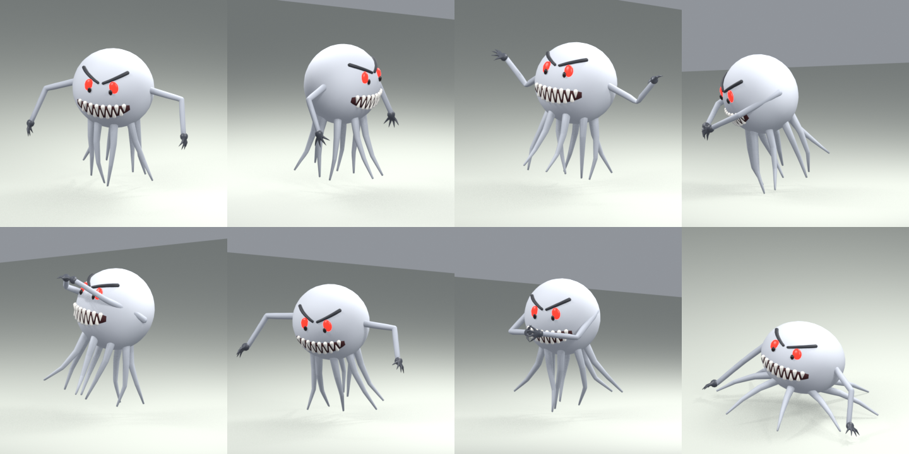
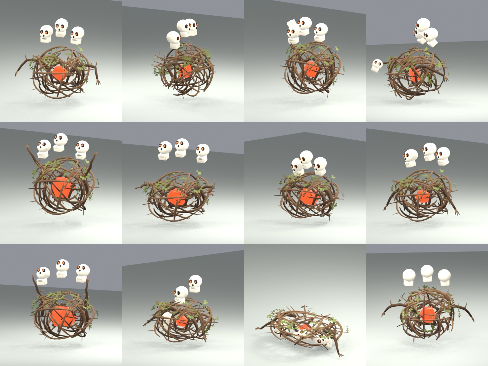
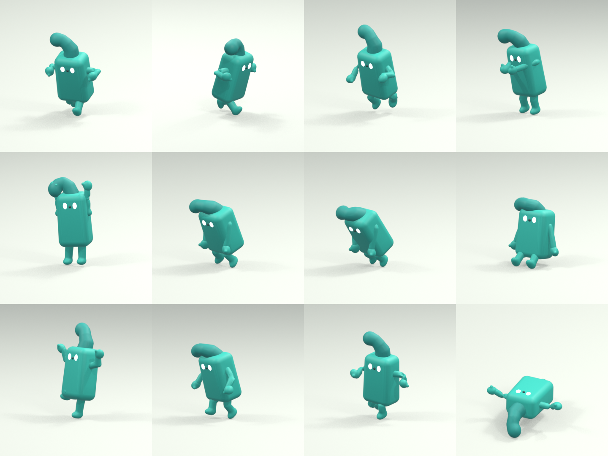
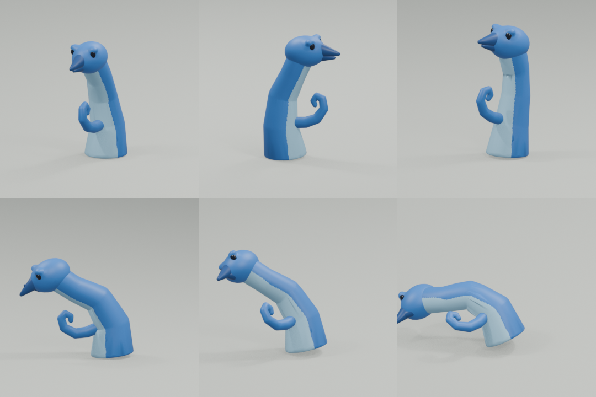
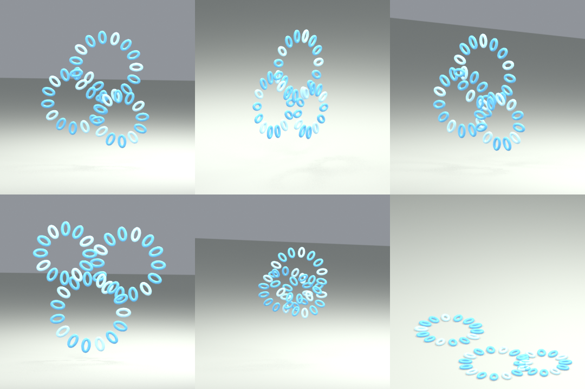

# Bosses

A real boss takes the place of one depth's descent guardian; the other descent guardians stay
boss placeholders ([guardians.md](guardians.md)): the game calls them **Temp Bosses**
(`♛ Temp Boss Spider`), as they hold the place of bosses to come. `BOSSES` in `src/core/bosses.js` says which
depth has which: so far the first descent, on the road out of town (depth 0), has **Gusto**, the
second (depth 1) **Totnar**, the third (depth 2) **Squarlo** and the fourth (depth 3) **Flip**. A
boss may bring an arena of its own (`BOSS_ARENAS`: Squarlo's tidal hills, Flip's box).

The layout marks that arena's guardian with `boss` (`world/layout.js`, `cubegen/guardian.js`;
`bossPlaceholder` is false there). The boss stands on the guardian's spot **alone**: no
defenders, it brings its own (`game/enemyspawn.js` `bossSpot`). It is a guardian in every other
way: the descent guardian's level, id, gate, seal, amber HP bar and drops; its death alone opens
the well, for good. Its label shows its name (`♛ Gusto · Lv 1`), the locked well says
"Defeat Gusto to unlock this descent", and the music turns to the boss mood like for any
guardian. Once hurt, or once it has struck, it no longer keeps to its post (`game/defence.js`);
out of his arena (a dev spawn, the boss test room) he fights on the same (`relentless`,
`game/enemyai.js decide`).
Like every guardian's arena, leaving it while the boss lives asks first, and being pushed against
the entrance never takes you out ([guardians.md](guardians.md#encounter-and-persistence)).

Each boss runs its own fight (`game/gusto.js`, `game/totnar.js`, `game/squarlo.js`, `game/flip.js`, its
rules in `core/gusto.js`, `core/totnar.js`, `core/squarlo.js`, `core/flip.js`); what they share is `game/bossfight.js`: the players in the fight, sending a
body into it, the floors a body fits on, putting minions down round their boss and letting
bodies go. A boss's minions (`minion` kinds, summoned) live in no roster: they pay a little XP
once, no coins, no weapons, now and then a minor health potion, and go with their boss when it
dies.

## Gusto



From the kids' whiteboard sketch (`blender/gusto.py`, `assets/gusto.glb`): a big round,
white-grey head with a V of angry brows, glowing red eyes and a wide grin of jagged teeth
(upper row down, lower row up, interlocking). Two long thin arms come out of its sides and end
in four dark claws. Eight thin tentacles hang from its underside: it floats (`hover`), they never
touch the floor, and they move like crazy: the clips only sway them, the game shakes every
tentacle bone on top of whatever clip plays (`flail`, `render/enemies.js`). About 2.3 cells
tall. Its eyes flare up while it winds up an attack.

Profiles: `GUSTO` and `GUSTO_SPLIT` (phase 2) in `src/core/enemies.js`; the fight's rules in
`src/core/gusto.js` (`GUSTO_FIGHT`); the fight itself in `src/game/gusto.js`.

| | Level 1 |
|---|---|
| Health | 1000 (the descent tier's floor) |
| Damage | 24 (grab ×1.4, vortex ×0.5; breathing in: none) |
| XP | 650; coins 120–220; two weapons and two potions like a descent guardian |
| Poise | 2 s |

### Phase 1 (full health to half)

- **Grab and throw** (within 1.6 cells, clip `GustoGrab`, 2.2 s): it spreads its arms wide and
  leans back (the tell), lunges and catches at 0.73 s whoever is within 1.8 cells in front of it.
  Caught, the player is held in its hands (`game/grab.js`): no moving, no striking, nothing else
  hurts them, and there is no wriggling free. It lifts them up high in front of its face along
  the clip's grip path (`grab.grip`, read off the clip by `blender/gusto.py`) and at 1.53 s throws
  them down in front of itself: then the blow lands (34 at level 1) and they go over as a
  ragdoll and get up as after any knock-down. A stagger (a heavy blow, a friend's) or its death
  makes it let go: the player drops unhurt.
- **A grab that catches nothing** (the grab's `miss`, `game/enemyai.js whiff`): it goes on into
  `stuck` (clip `GustoStuck`, 2 s): from the catch pose it overshoots and face-plants, arms splayed
  on the floor, tentacles flopping, and heaves itself back up. Until 1.6 s (`exposed.until`)
  every weapon blow does ×1.5 (`exposed.damage`, `core/combat.js weaponHit`, the number shown is
  the bigger one) and none staggers it out of this (`damageEnemy`). Every game shows the crash
  (`game/gusts.js`, `felledFx`: a thump, dust) and says "Gusto missed! Hit him while he is
  down". So reading the tell (arms flung wide and up) and stepping out of reach pays, with any
  weapon; a proxy that misses falls the same way.
- **Breathing in** (`inhale`, within 2 to 9 cells, clip `GustoInhale`, 2.4 s), also in phase 2:
  once the nearest player has kept more than 4 cells (`GUSTO_FIGHT.far`) from it for 3 s
  (`wait`), it starts nothing else (`barred`, `game/gusto.js`). The tell: it sweeps its arms
  back behind it, tips its face up and empties itself; at 0.5 s it lunges its face forward, arms
  out to scoop, and for 1.3 s sucks in whoever stands in the cone before its mouth (9 cells long,
  0.7 either side at the mouth widening by 0.5 per cell) with a clear line to it, swelling all
  the while, then gulps. Pulled at 4 cells/s (`pull.speed`) up to 1.5 cells from it
  (`pull.stop`); away from it the player keeps only a quarter of their steering (`pull.hold`),
  but sideways all of it, and it stops turning at 1 s: stepping out of its breath escapes. It
  does no harm; it recovers in 0.2 s (`recover`), and for 1.5 s after it only a grab may start
  (`follow`). One of the three at a time, every 8 s at most (`breathCool`). Every game pulls its
  own player off the attack clock (`player.pull`, `physics/move.js`), so nothing is sent.
  Shooting from afar is still the safer way, but it no longer keeps the player out of his hands.
- **Summon** (within 8 cells, clip `GustoSummon`): it rears back with its arms up and spits Custo
  triangles from its mouth at 0.9 s, onto free floors around it: as many as fill up to **three**.
  It summons again only while fewer are about, at most every 7 s (the first after 1.5 s of
  fighting).
- No blow takes it below half its health (`hpFloor`, `core/combat.js` `damageEnemy`).

### The split

At half its health it stops, shudders and steams (mode `split`) and nothing hurts it for 1.8 s.
Then **three Gustos** appear on spots of the fight zone at least 3 cells apart from each other
and from the players (closer where the arena does not allow that): the real one on any of them,
and two **proxies**.

### Phase 2 (half health to death)

- All three fight the same: the grab, the **vortex**, the summon and breathing in. Their attacks are out of
  step, so they do not all blow at once.
- **Vortex** (within 4.4 cells, clip `GustoBlow`, 2.1 s): it brings both hands up in front of its
  mouth and breathes in from 0.3 s (air spirals into its hands, it swells), and at 1 s blows a
  vortex through them for 0.6 s: a gust like the Wolla's (`core/gusts.js`, `game/gusts.js`,
  kind `vortex`), 5 cells long, 0.45 either side at the hands widening by 0.4 per cell. A player
  in it is hit once (12 at level 1) and blown back at 10 cells/s fading over 0.7 s (about 3.5
  cells). It stops turning at 0.85 s: stepping out of the cone then dodges it.
- Summons now fill up to **two** Custo triangles; any of the three can summon.
- **Proxies** look exactly like it, carry its name and show its health (their bars drop with
  its own). Any hit at all, however small (a burn tick too), makes one go up in a cloud: no XP,
  no loot. The real one takes damage like any enemy: the play is to find it, and mostly to beat
  it while one proxy still stands.
- When the **second proxy** goes, the real one can still be hit for **1 second** (if it is in
  the middle of an attack, until that is over). Then it vanishes in a cloud (mode `gone`: it
  cannot be seen, hit or touched; `absent` in `core/enemies.js`), and 1.3 s later it and two new
  proxies appear on new spots, as after the split. For 0.5 s after appearing nothing hurts them.
- Its death takes its proxies and triangles along, in clouds (no XP for them).

## Custo triangle

`CUSTO_TRIANGLE` (`src/core/enemies.js`): a kind of the Triangle, half its size, light blue,
1.9× as fast, with a weaker, faster punch (9.5 cells/s) that does **not** knock the player over.
It lives in no roster (`minion`): only Gusto brings them, and they go for the player at once.
Each pays a little XP (11 at level 1) once (`awarded`; never remembered as defeated), no coins
and no weapons, and drops a minor health potion 8% of the time (`drops`,
`core/gear/drops.js`). All the real XP is Gusto's.

## Totnar



From the kids' whiteboard sketch (`blender/totnar.py`, `assets/totnar.glb`): a tumbleweed, a
ball of tangled sticks and clumps of dry leaves, about 2.4 cells tall with his skulls. In the
middle burns his heart, a red hexagon of embers in a pentagon of thick sticks; three skulls
float above the ball, side by side, bobbing out of step and clacking their jaws; two long stick
arms with twig fingers come out of his sides. The game rolls the ball by the distance he covers
(`tumble`, `render/enemies.js`: the bone `brush`), and he sheds leaves and twigs as he rolls
fast (`litter`). His skulls glow faintly, so they show in the dark.

The sticks lie in three layers round the heart. Each time he loses a skull, one shell of
sticks goes with it (`shed`: the bones the game scales away at each stage, with a burst of bone
shards or sticks and leaves and a crack): stage 2 loses the right skull and the outer shell,
stage 3 the left one and the middle shell. So his heart shows more and more, and its light
grows (`grow` in `render/enemies.js` GLOW).

Profile: `TOTNAR` in `src/core/enemies.js` (all his attacks on one profile; the fight bars
those not of his stage); the fight's rules in `src/core/totnar.js` (`TOTNAR_FIGHT`); the fight
itself in `src/game/totnar.js`.

| | Level 3 |
|---|---|
| Health | 1340 (the descent tier's floor, grown two levels) |
| Damage | 29 (skull ×0.7 and a push, roll ×1.3 and a knock-down, lightning ×0.9 and a stun) |
| XP | 650 grown; coins 140–240 at level 1; two weapons and two potions like a descent guardian |
| Poise | 2 s |

### The dark

All fight long he makes it dark, and after a while light again: the gloom (clip
`TotnarGloom`, 1.7 s; any distance, any height): he spreads his arms high, the ball swells and
the skulls gape, and at 0.9 s he sweeps his arms down. The darkness is sucked into his heart (or
the light bursts out of it) and the whole cube turns to night over a second or so
(`state.dark`, `render/look.js` NIGHT): the sky and the sun all but go out, the far side sinks
into the dark, stars come out. What still shines are the fires, his heart, the skulls' eyes, the
lightning and the player's own light (at its brightest meanwhile). Five braziers burn round the
edge of his arena (`BOSS_ARENAS`, `cubegen/arenaprops.js`), away from his post. He first makes
it dark 3 s into the fight; the light lasts 5–9 s, the dark 8–13 s. When it is due he starts
nothing else. Each time he loses a skull it is light at once, for 6 s at least; his death
brings the light back for good.

### Stage 1: three skulls (full health to two thirds)

- **Skull throw** (within 7.5 cells, clip `TotnarThrow`, 1.4 s): he reaches into his sticks with
  the right hand, pulls out a skull, draws it back over his head and hurls it at 0.8 s. It flies
  tumbling at 7.5 cells/s (turned to cross his aim where the player is, `converge`). A hit hurts
  (20 at level 3) and pushes the player back at 7 cells/s fading over 0.45 s.
- Wherever it ends (a player, the level, its range), it comes to life: a **snapping skull**
  (`becomes`, `game/projectiles.js` tells him, `game/totnar.js`) on the nearest free floor, at
  most four at a time. It hops after the player and bites (with a little pounce); after 7 s it
  crumbles in bone dust.
- No blow takes him below two thirds of his health (`hpFloor`).

### Losing a skull

At two thirds (and at a third) of his health he stops (mode `split`): a skull bursts off him
with a shell of his sticks, nothing hurts him for 1.6 s, and the light comes back. Then he
fights on with the next stage's attacks.

### Stage 2: two skulls (two thirds to a third)

- The skull throw and the dark, as before.
- **Twig spiders** (clip `TotnarSummon`, 1.6 s): he grips his own ball and tears it open,
  shaking, and at 0.9 s small spiders of twigs pour out of it (Spiders at 0.55×, fast and weak)
  onto the floors around him: as many as fill up to **eleven**, every 9 s at most.
- **Roll** (from 1.6 to 8 cells, clip `TotnarRoll`, 3.5 s): he crouches, tucks his arms in and
  pulls his skulls down while the ball spins up in place (the tell), and at 0.8 s rolls at the
  player at 7 cells/s, turning towards them at no more than 0.8 rad/s. What stops him (a wall, an
  edge: he never rolls off one) bounces him off, towards the player if they are that way, with a
  thump and dust; after two bounces the next stop ends the roll. Whoever he touches is run over
  (37 at level 3) and knocked down, once a roll. While he rolls no blow staggers him (`steady`,
  `core/combat.js damageEnemy`); a heavy blow in the wind-up still stops it. At 2.6 s he stops
  and sits dizzy, skulls circling, until the attack is over: the time to hit him.

### Stage 3: one skull (a third to death)

- No more throws and rolls; the snapping skulls left crumble.
- **The storm** (within 9 cells, clip `TotnarStorm`, 1.9 s): he raises his arms, his heart
  flares and his skull gapes at the sky. From 0.4 s three storm clouds gather high above the
  player and two spots 1.4–2.4 cells round them, each with the Wolk's crackling ring on the floor
  (`bolts`, `sky`, `core/beams.js`, `game/beams.js`); the rings follow the player for 0.65 s and
  hold still for the last 0.35 s. At 1.4 s the lightning strikes out of the sky: whoever is in a
  ring is hurt (26 at level 3) and stunned for 0.8 s; the thunder rolls in after. A stagger puts
  the storm out.
- **Bramble stunders** (the summon's clip): Stunders at 0.72×, weaker, whose rams do not knock
  you over: as many as fill up to **two**.
- The dark, as before.

His death takes his minions along (in dust and leaves) and brings the light back.

## Totnar's minions

All three live in no roster (`minion`), pay a little XP once and drop a minor health potion now
and then (`drops`); they turn up and go in a puff of dust and leaves, the skulls in bone dust
(`puff`, `render/enemies.js`).

| | Kind of | Size | Notes |
|---|---|---|---|
| Snapping skull | its own species (`SNAP_SKULL`, `assets/snapskull.glb`) | 0.55 tall | hops and bites, crumbles after 7 s |
| Twig spider (`TOT_SPIDER`) | Spider | 0.55× | twig brown, ember eyes, ×0.4 health, ×1.2 speed |
| Bramble stunder (`TOT_STUNDER`) | Stunder | 0.72× | no knock-down, ×0.55 health and damage |

## Squarlo



From the kids' whiteboard sketch (`blender/squarlo.py`, `assets/squarlo.glb`): a tiny teal
fellow, about 0.7 cells tall, smaller than the player. A tall, boxy body splits at the bottom
into two short, stubby legs; a floppy cap on top bends over to his right and ends in a round
bulb; his face is three dots (two glowing eyes and a nose between them); two short arms bend up
at the elbows into cupped hands. In his second phase the game draws the same model about nine
times as big (`SQUARLO_GIANT` `size`): a giant six cells tall.

Profiles: `SQUARLO` and `SQUARLO_GIANT` in `src/core/enemies.js` (`STAGE_PROFILES`: one for each
of his stages); the fight's rules in `src/core/squarlo.js` (`SQUARLO_FIGHT`); the fight itself in
`src/game/squarlo.js`, his water in `src/game/tide.js`.

| | Level 4 |
|---|---|
| Health | 1510 (the descent tier's floor, grown three levels) |
| Damage | 31 (jet ×0.85 and a push, stomp ×1.5 and a knock-down; the tide, summons and rests: none) |
| XP | 650 grown; coins 150–260 at level 1; two weapons and two potions like a descent guardian |
| Speed | 4.2 cells/s (the player runs 2.8); a giant 1.5 |
| Poise | 2 s |

He `swims`: no water drowns him, and in water deeper than half his body he floats in it,
paddling (`game/tide.js floatSwimmers`, the clip `SquarloSwim`).

### His arena: the tidal hills

His descent arena is always of a type of its own (`BOSS_ARENAS.squarlo.type`,
`cubegen/arenashapes.js` `tidal`, `TIDAL`): a basin of low flats three levels under the doorways,
little hills standing out of it and a bank of scenery round the cube just inside its edge that
keeps the water in. A hill is steep: a top of two by two (now and then three by three) cells a
level over the doorways, a cliff on every side but one, where a ramp comes down to the flats a
level a cell; so the hills take little room and the flats stay wide. There are at least four
(`peaks`; five are tried, spread out, smaller and closer where they do not fit), and where a
floor of the flats is still too far from ground to wade on, another hill (or, where none fits, a
low knoll) grows there. Nothing in the arena blocks (a giant walks it, the water comes and
goes); the hills have the biome's cover and small things and a cairn on top, the flats shells and
sea glass.

Its water (`map.tide`): at rest it stands 0.8 levels over the flats, at high tide 0.45 levels
under the doorways, inside the box of cells within the bank (`box`), which the doorways, the
hilltops and the bank stay above. At high tide the flats drown, the slopes down from the
doorways and the ramps are waded through, and the hilltops and the doorways stay dry. From every
floor there is ground a body can wade at high tide within four steps (`stepsUp`), and running
there, slowed by the water, takes less time than the tide does to get over the head there
(`tests/squarlo.test.js`).

The water is a standing fluid like a flood trial's (`physics/fluid.js setTide`; drawn like the
trial's rising water, `render/trials.js`, only in its box): its level follows his `tide` (0 at
rest .. 1 at high tide, `core/squarlo.js tideLevel`). It drowns what it goes over the head of
(see [Water](#water-wading-and-drowning)), enemies too (without rewards).

### Phase 1 (full health to half)

- **Jet** (within 4.2 cells, clip `SquarloBlow`, 1.6 s): he cups his hands at his chest and
  leans back while the water gathers in them, then at 0.8 s thrusts them forward and a jet of
  water blows out of them for 0.5 s: a gust (`core/gusts.js`, kind `jet`), 4.6 cells long. A
  player in it is hit once (26 at level 4) and blown back at 9 cells/s fading over 0.55 s.
  Stepping out of its cone before it blows dodges it. Never while his water is up.
- **Squirtles** (within 9 cells, clip `SquarloSummon`, 1.4 s): he slaps the floor in front of
  him at 0.8 s, and Tide squirtles pop out of the floor round him: as many as fill up to
  **three**, every 9 s at most (the first after 4 s of fighting).
- **The tide** (from anywhere, clip `SquarloCast`, 2.4 s): once it is due he starts nothing
  else: 8 s into the fight, then 13–19 s after the last tide drained. He throws his arms up and
  wiggles, water spiralling up round him (every game says "Squarlo calls the tide! Get up a
  hill!"); **nothing hurts him while he casts** (`ward`, `core/enemies.js wardedNow`). At 2 s he
  slams his arms down and the water rises: from its rest level to high tide in 3.5 s, stands there
  for 6 s and falls back in 3.6 s.
- **Rest** (clip `SquarloRest`, 2.2 s): after every tide, and after every three other attacks,
  he has to sit down and catch his breath (every game says "Squarlo is out of breath! Hit him
  now"): from 0.2 s to 1.93 s every weapon blow does ×1.3 and none staggers him out of it.
- No blow takes him below half his health (`hpFloor`).

### Growing

At half his health he stops (mode `split`): a fog rolls in round him (and over the cube:
`state.mist`, `render/look.js`), he groans and grows over 3.2 s into a giant six cells tall,
nothing hurting him until 0.6 s after. Then he fights on as `SQUARLO_GIANT` (his `stage` 2).

### Phase 2 (half health to death)

- He walks the floors like any enemy, over the hills (the clip `SquarloStride`), but keeps his
  body off the bank (`keepIn`). Only his legs are in reach of a blade; a player on a hill
  higher than his feet reaches him only with a bow, a crossbow or a staff.
- **Stomp** (within 5 cells, clip `SquarloStomp`, 3.2 s): he leans onto his left foot and
  lifts the right one high, wobbling (the tell). From 0.4 s his foot's shadow (a beam of kind
  `stomp` out of the sky, `core/beams.js`, `render/beams.js`) follows the player at 2.6 cells/s,
  for the last 0.45 s it holds still, flashing; his foot moves with him to over the shadow
  (`plant`). At 1.9 s it comes down there: whoever is within a cell of it is stomped (47 at
  level 4) and knocked down; a boom, the ground shaking, a ring of dust and spray. The foot
  stays planted until 2.9 s: every blow does ×1.4 meanwhile ("Squarlo is stuck! Hit his foot").
- The tide, the Squirtles (up to **two**, every 11 s at most) and the rests, as before.

His death drains the water and takes his Squirtles along.

## Squirtle



From the kids' sketch (`blender/squirtle.py`, `assets/squirtle.glb`): a little blue water serpent
with a beak. Its body pokes out of the floor and rises in a curve, leaning back, into a round head
looking forward; a little curl sticks out of its front, its belly is pale. Profile: `SQUIRTLE` in
`src/core/enemies.js`, a species of its own in the rosters.

- It **runs about under the floor** (`burrow`, `game/enemyai.js`): in the fight it stays up for
  2.4–3.6 s, then (not in the middle of a throw) dives and moves about under the floor at
  3.4 cells/s for 1.4–2.4 s, and comes up again where it has a shot (or a little later anyway).
  Under the floor (`under`) nothing sees, hits or touches it (`core/enemies.js absent`); its
  bar and label go, a trail of dirt (of spray in water) follows it, and it sinks in and pops out
  with a scrape and a pop (`render/enemies.js burrowLook`). Out of the fight it stays up.
- Up, it fights from afar (`style: 'ranged'`, 2.4–4.4 cells, from 5): it rears back, puffs up
  and spits a ball of water at 0.5 s (a projectile, 7.5 cells/s): 13 at level 1 and a tiny push
  (2.4 cells/s for 0.15 s).
- It `swims`: no water drowns it.

| Kind | Where | Health, damage | Notes |
|---|---|---|---|
| Squirtle | the lagoon isles (depth 2), the sunken grotto (9–10) | 42, 13 | blue |
| Coral squirtle | the sunken grotto (9–10), the jungle cenote (13) | ×1.5, ×1.4 | coral red, ×1.1 speed |
| Tide squirtle | Squarlo's (`minion`) | ×0.7, ×0.6 | teal; pops out of the floor round him, a little XP once, now and then a minor health potion |

A roster entry may keep to some themes (`where` in `core/spawns.js`: the biome, the theme's prop
set): the Squirtles live only in those waters.

## Water: wading and drowning

Lava and acid kill on contact. Water only drowns a body whose head goes under
(`physics/fluid.js`): the player's head starts 0.79 cells over their feet (`HEAD_Y`: the rig's
head bone, 1.44 rig units up, at `CHAR_SCALE`), an enemy's at its `bodyHeight`. In shallower
water the player wades: walking goes on into it (`physics/canmove.js` stops only at water too
deep), slowed by up to 45% the deeper it is (`WADE_SLOW`, `physics/move.js`). The rivers and
pools of the cubes are a cell deep (their beds two levels under the surface): over the head, so
they drown as before; the rising water of a flood trial and Squarlo's tide are waded through
until they get over the head. That water writes depth (`render/trials.js`), so what of a wading
body is under its surface stays hidden (the hero is drawn after it); and the cutaway never cuts
lower than its surface where the hero stands in it (`game/cut.js`), or it would drop the water
round their legs.

## Flip



From the kids' sketch (`blender/flip.py`, `assets/flip.glb`): three rings of smaller rings. Each
big ring is a wreath of little oval loops lying in its plane, long side outward; the rings overlap
like the sketch, a big one on top, one to the left and lower, a smaller one to the right and
lowest. All light blue, glowing a little; about 2.2 cells tall, floating (`hover`). The rings turn
now and then, each about its own axis, every other one the other way (`rings`,
`render/enemies.js spinRings`): still for a while, then turning; fast while he winds up, wildly
while he spins up at half his health.

Profile: `FLIP` in `src/core/enemies.js` (all his attacks on one profile, the fight bars those not
of his phase); the fight's rules and his box in `src/core/flip.js` (`FLIP_FIGHT`); the fight in
`src/game/flip.js`, the world he turns in `src/game/flipworld.js`, drawn by `render/flipview.js`.

| | Level 5 |
|---|---|
| Health | 1680 (the descent tier's floor, grown four levels) |
| Damage | 34 (ball ×0.7, volley ×0.55 a ball; a fall out through a hole ×0.6, a black hole's swallow ×0.55; a flip: none) |
| XP | 650 grown; coins 160–280 at level 1; two weapons and two potions like a descent guardian |
| Poise | 2 s |

### His arena: the box

His descent arena is always a box (`BOSS_ARENAS.flip.type`, `cubegen/fliparena.js`): solid cells,
a unit each way, 16 × 16 × 16 of them (`map.flip.solid`, each marked with the side it belongs
to). A floor as thick as the doorways' level, four walls a cell thick round the whole cube (they
are the cube's sides), open at the top, and a floating island in the middle (a disc 4 cells round,
2 thick, 5 over the floor). Each wall has three or four holes up high, out of reach from the floor
(the entrance's doorway is a hole too, low in its wall).

Every side that can be the floor has things to climb and fight round (`FEATURES`): daises a cell
high with a stair up the front, towers two high with a flight of two stairs, low ledges with a
stair up each end, little stepped pyramids, humps two high with a flight up each end, and pillars;
the island's underside (its floor upside down) has a pyramid in the middle. A stair cell
(`map.flip.stairs`, `stairUp`: the way it rises and the way its treads face) is a slope a cell up
for the physics, like the game's own stairs, drawn as four steps; turned any other way it is a
whole cell. On a wall these things stand out of it overhead. And every side has a **balcony**
(`shelves`): a platform 5 by 4 cells, a cell thick, four cells up, jutting out of one of the walls
beside it (`host`), with a staircase of four stairs straight out from its front, floating free of
the floor. Turned so that its side is down the fight may go on up there; on other sides it is a fin
or a ledge like the rest. Each balcony and each thing to climb is only kept if, whatever side is
down, the floor stays one walkable piece and every balcony is climbed from its own side (the
generator turns the box every way to check). They all keep clear of each other, the holes, the
middle of each side, and on the floor of the box of the doorway, the well, his spot and the way
between them.

Clutter is glued to every side (`map.flip.clutter`: the theme's small things and frost crystals,
none of them blocking), its up the side's, so it is right whichever side is down and turns with the
box; it goes with a wall that breaks open.

Any side of it can be the floor: an orientation (a rotation of the box about its middle, one of
24, `ORIENTS`) says which way it is turned, and `orientedFloors` builds the floors of the box
turned that way for the physics, which stays the game's own: every run of solid cells up a column
is a floor, stacked where the cells are (the walls, the island). The side overhead is left out (and
not drawn: it would hide everything from the camera). The holes in the side that is down are thin
floors over the gap (`hole`) until they open (`open`: then nothing stands on them,
`physics/collide.js`, `physics/floornav.js`). Unturned, the box is the cube's own map; turned,
`state.map` is the turned one (`game/flipworld.js orientedMap`; no portals while turned). The
active cube draws each side and the island as meshes of their own in a pivot at the middle of the
box (`render/flipview.js`), which the turn turns; the island is see-through while it is not the
floor (it would hide the floor under it). The neighbours see the box as it was built (its cube
parts, `render/flipgeo.js`). The cutaway takes down what stands out of the walls too (a wider band
than for canyon walls, `render/section.js`).

**The walls break open.** When the fight starts, and every time the holes of the side down burst
after a turn, the walls round the floor break open (`brokenWalls`): all of them but a parapet two
cells high over the floor, a frame a cell wide round their edges and the wall round the foot of the
side down's balcony, in big pieces flying off, spinning and fading, with dust and a boom. So little
hides the fight and the cutaway has little to do. The physics goes without those cells (`removed`)
till the walls are put back: when he winds up his next flip (or a black hole has the player) the
pieces fly back together, before the world turns. Once he is dead they fly back together and stay.

**The world round the box goes** while the fight is on (from when he first engages till he dies):
the neighbouring cubes fade out and the sky turns as dark as it goes, only the stars
(`state.void`, eased in `main.js`; `render/look.js` VOID, `render/neighbors.js setNeighborVeil`),
so the box turning hangs in nothing. The box itself stays lit as before. Beaten (or the fight
put back after a death), the regular backdrop comes back.

Its walls are the cube's sides, so the shared ring of border cells does not match the neighbours'
ground there (only the doorway does): the one place in the world where it does not.

### Phase 1 (full health to half)

- **Ball** (within 8 cells, clip `FlipThrow`, 1.2 s): he leans back, his rings drawing together,
  and at 0.6 s thrusts forward and throws a ball of light out of his top ring (a projectile, 8.5
  cells/s, 24 at level 5).
- **Sky wollas** (within 9 cells, clip `FlipSummon`, 1.4 s): he bows and flicks his rings up at
  0.8 s, and Sky wollas come out of them: as many as fill up to **three**, every 11 s at most (the
  first after 5 s of fighting).
- **The flip** (from anywhere, clip `FlipFlip`, 2.2 s): once it is due (7 s into the fight, then
  every 13–18 s) he starts nothing else. His rings rise and spread and he cartwheels right round;
  **nothing hurts him while he casts** (`ward`). At 1.33 s the world turns: the box turns a quarter
  round about its middle in 1.5 s (half round, between the floor and the open top, in 2.1 s), so a
  wall next to the one down, the floor or the top comes down (`nextDown`: never the opposite wall),
  and everything in it turns with it: the player (carried, no steering), the enemies (frozen), the
  loot; projectiles in flight go. Then the enemies drop onto clear spots of the new floor, ones
  their bodies fit on (`bossfight.js fitting`: not in a wall, not under a ledge, not a hole or a
  stair; a minion with none is lost, without a reward), he first, and **his tractor beam** (a shaft
  of light blue light from his rings) carries the player to a clear spot near where the turn took
  them, at least 2.5 cells from him, in 0.6 to 1.8 s: nothing hurts them meanwhile, and nobody
  strikes for a second after (`grace`). Turned upside down the spot is on the island. Two times in
  five (`balcony`) the fight goes on up on the side down's balcony: he and the player are put up
  there.
- **The holes**: the holes in the side that comes down are shut (panes of ice over them) while
  the beam carries the player; 1.1 s after they are down the holes crack (the panes flicker) and
  0.9 s later burst open (and the walls break open): whoever stands on one falls out of the world,
  and so does a minion. Falling out hurts (20 at level 5) and puts the player back where they last
  stood. Unturned, the floor has no holes; the walls' holes are windows.
- No blow takes him below half his health (`hpFloor`).

### Spinning up

At half his health he stops (mode `split`), his rings spin wildly and nothing hurts him for
2.4 s. Then he turns the world upside down (or, upside down already, the right way up) and fights
on in phase 2.

### Phase 2 (half health to death)

- **Volley** instead of the ball: three balls at once, fanned out 0.3 rad apart (`volley`, `fan`,
  `game/projectiles.js`), 19 a ball.
- **Black holes** (within 9 cells, clip `FlipHole`, 1.8 s): his rings crowd into a knot, shaking,
  and burst apart at 1.07 s: two black holes open on the floor, one 1.6–2.8 cells from the player,
  one 3.5–6 cells away; they last 6.5 s (one at a time, 9–13 s apart, the first 3 s into the
  phase). While one is open (or has the player) the scene darkens like Totnar's dark
  (`state.dark`). Each grows over 0.6 s, then the nearest pulls the player in from up to 5.5 cells,
  harder the closer (1.3 to 3.1 cells/s; the player runs 2.8), keeping 30% of their steering away
  from it (`player.pull`, `physics/move.js`). One that gets them to its middle swallows them (19 at
  level 5): they are gone (`player.vanished`, nothing hits them), the world turns for it (a flip
  like his own), and a moment after it they come out of another black hole on the new floor, away
  from him, with a little hop.
- **The flip** as before, but the beam becomes a black hole: as the world starts to turn one
  swallows the player (no harm), and when it has turned they come out of another at the spot the
  beam would have taken them to.
- The Sky wollas (up to **three**, every 10 s) and the holes, as before.

His death takes his Sky wollas along and turns the world the right way up again: the well is in
the floor.

## Sky wolla

`SKY_WOLLA` (`src/core/enemies.js`): a kind of the Wolla, light blue (`frost.light`), ×0.6 health
and damage, that lives in no roster (`minion`): only Flip brings them, and they go for the player at
once. A little XP once, no coins and no weapons, a minor health potion 6% of the time.

## Playing together

The game that runs the cube's enemies runs the fight; the others are shown it (`net/foes.js`):
proxies and triangles appear in the roster like any enemy (`proxy`, `summoned`, `noReward`), and
the modes `gone` and `split` go along. A grab is a blow like any other (`blow.grab`: the enemy's
id): the game of the player it caught carries it out, after the Gusto as it is shown there.
Enemies the runner lets go of without killing them pay nothing. Totnar's stage and whether he
keeps it dark go along with his row (`stage`, `dark`, `net/protocol.js rowOf`), and so do the
other bolts of his storm (`bolts`, shown like his beam, `game/beams.js mirrorBeam`); his thrown
skulls fly there like any projectile, but only the runner brings them to life. A game that takes
over running his cube (`adoptEnemies`) starts him at the stage his health gives: he loses the
skulls he has lost again at once. Squarlo's stage (2: a giant), how high he has the water
(`tide`, 0 to 1) and whether a Squirtle is under the floor (`under`) go along with their rows
(`net/protocol.js rowOf`): a friend's game swaps his profile by his stage (`STAGE_PROFILES`,
`net/foes.js`) and raises its own water by his tide (`game/tide.js`). Flip's row carries one more
slot: the way his box is turned (an index into `ORIENTS`), how often he turned it and his black
holes. Every game turns its own world after them (`game/flipworld.js`: its own player carried and
falling, the enemies shown as the runner moves them) and is pulled by the holes; a friend a black
hole swallows comes out of another after a moment, without a turn (only the runner's player makes
him turn the world).

## Dev

`/spawn gusto` spawns one anywhere, with its fight (`game/devspawn.js` `addGustos`); `/kill`
kills it whatever its phase. `/spawn custotriangle` spawns its minions on their own. Likewise
`/spawn totnar` (`addTotnars`), `/spawn snapskull`, `/spawn totspider` and `/spawn totstunder`,
and `/spawn squarlo` (`addSquarlos`; without his tidal hills he calls no tide), `/spawn squirtle`,
`/spawn coralsquirtle` and `/spawn tidesquirtle`. `/arena tidal` goes to his arena. `/spawn flip`
(`addFlips`; out of his box he turns nothing, and a black hole lets a swallowed player out
elsewhere without a turn) and `/spawn skywolla`; `/arena flip` goes to his box.

`/boss gusto` goes into the real arena (one beaten is up again). `/testroom boss gusto` (or
`/testroom boss 0`: a boss, or the depth whose boss it is) goes into his **test room**
(`cubegen/testrooms.js bossRoom`): the very descent arena of his depth in this world, built by
the generator from the world's spec of it (`world/world.js descentSpec`, `cubegen/guardian.js`),
so with the arena type he brings (Squarlo's tidal hills and their water, Flip's box, which he turns
there too), Totnar's braziers
and the fight zone his minions are put down on (`game/bossfight.js fitting`: any map with an
`arena`). It is made a test room: no portals (the entrance and the well are plain ground), no
gate, no guardian of the map's own, nobody but him. He stands in the room's lineup on the
guardian's spot facing you (you arrive at the entrance), idle (`dormant`) until hit, whatever
you do meanwhile: no dark, no tide, no minions. Hit, he fights as in his arena. A dev spawn
(`game/devspawn.js spawnLineup`), so nothing of him is remembered: no gate opens, the run marks
nothing defeated, a death (or `/testroom boss` again) puts him back, whole and idle. A depth
without a boss of its own has no boss room yet.

## Checks

```sh
node --test tests/gusto.test.js tests/totnar.test.js tests/squarlo.test.js tests/flip.test.js tests/testrooms.test.js tests/assets.test.js
```

```js
await (await import('./tests/browser/gusto.js')).runGustoChecks()   // the whole fight, in its arena
await (await import('./tests/browser/totnar.js')).runTotnarChecks() // Totnar's, in his
await (await import('./tests/browser/squarlo.js')).runSquarloChecks() // Squarlo's, in his tidal hills
await (await import('./tests/browser/bossroom.js')).runBossRoomChecks() // each boss's test room: idle until hit
```

Re-export the model with `Blender -b --python blender/gusto.py -- assets/gusto.glb
blender/gusto.blend blender/previews/gusto-preview.png`, then `npm run compress-assets`. The
grip path and the muzzles it prints must match `GUSTO` / `GUSTO_SPLIT` (`tests/assets.test.js`
checks them).

Totnar and the snapping skull: `Blender -b --python blender/totnar.py -- assets/totnar.glb
blender/totnar.blend blender/previews/totnar-preview.png assets/snapskull.glb`, then
`npm run compress-assets`. The throw, summon and storm points it prints must match `TOTNAR`
(`tests/assets.test.js`).

Squarlo: `Blender -b --python blender/squarlo.py -- assets/squarlo.glb blender/squarlo.blend
blender/previews/squarlo-preview.png`, the Squirtle: `Blender -b --python blender/squirtle.py --
assets/squirtle.glb blender/squirtle.blend blender/previews/squirtle-preview.png`, then
`npm run compress-assets`. The jet, summon and spit points and where the stomping foot comes down
that they print must match `SQUARLO`, `SQUARLO_GIANT` and `SQUIRTLE` (`tests/assets.test.js`).

Flip: `Blender -b --python blender/flip.py -- assets/flip.glb blender/flip.blend
blender/previews/flip-preview.png`, then `npm run compress-assets`. The throw and summon points it
prints must match `FLIP` (`tests/assets.test.js`).
